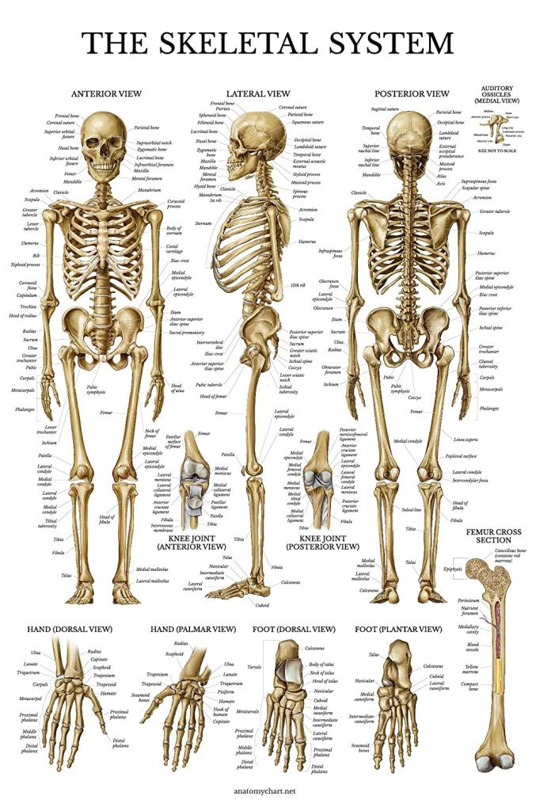
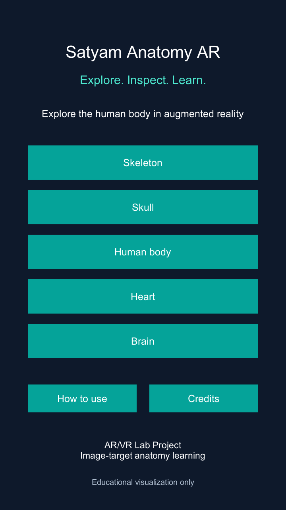
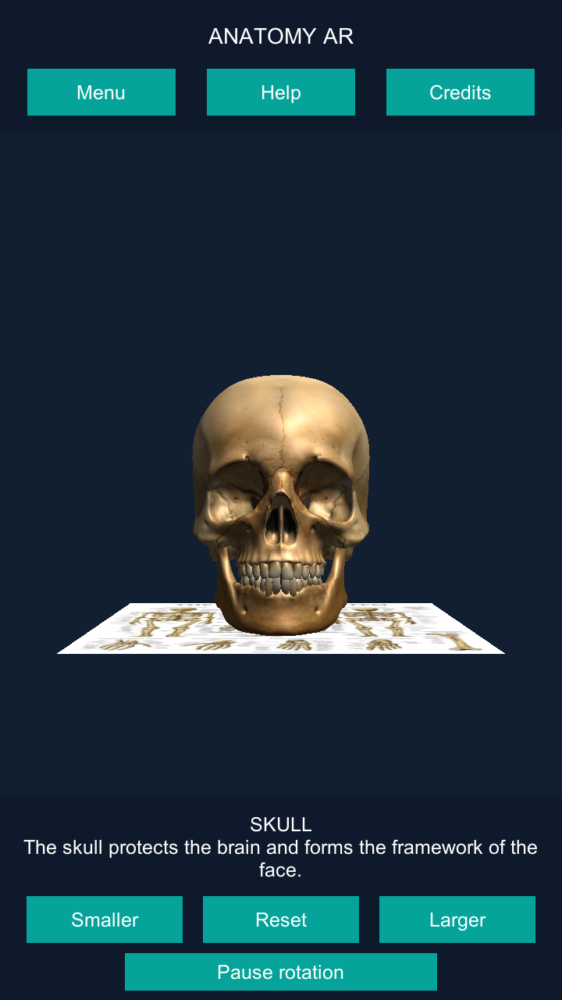
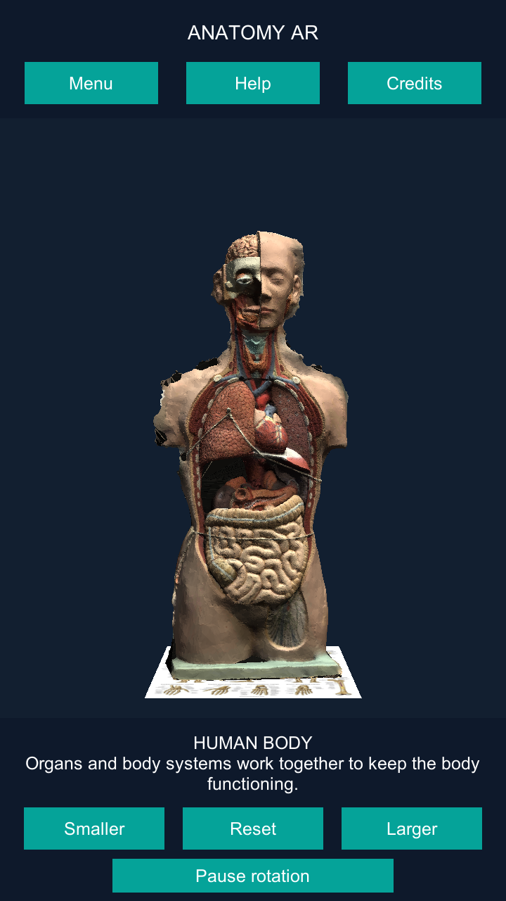

# Satyam Anatomy AR

**Explore human anatomy through a phone camera.** Select a body part, scan the supplied picture, and inspect a stored 3D model in augmented reality.

  

**[Download Android APK](https://github.com/satyampandey97610/AR_Anatomy/releases/download/v1.0.0/SatyamAnatomyAR.apk)** ? **[Project report PDF](Documentation/AR_Anatomy_Project_Report.pdf)** ? **[Editable Word report](Documentation/AR_Anatomy_Project_Report.docx)**

> **Verified:** Android build, APK archive, metadata and v1/v2 signatures. **Pending:** testing the adapted APK on the phone. The original baseline was reported working on a Tecno Spark Go 2023. Realme compatibility remains unverified.

## Get started

1. Download an APK from [Releases](https://github.com/satyampandey97610/AR_Anatomy/releases). Read whether it is the **original baseline** or the **Satyam adaptation**.
2. Install it on an Android phone and allow camera access.
3. Open [the target picture](Demo/TARGET-PICTURE.png) on a laptop, or print it. Download it before printing.
4. Select an anatomy model and point the camera at the complete picture.
5. Move the phone slowly to view the model from different angles.

**This is image-target AR. It displays existing models; it does not convert arbitrary photographs into 3D objects.**

## What is included

| Anatomy content | Interface added in this adaptation |
| --- | --- |
| Skeleton, skull, human body, heart and brain | New menu and consistent navigation |
| Original image-target database and models | Short educational descriptions |
| Original Vuforia tracking integration | Smaller/larger controls and reset |
| Automatic model rotation | Pause/resume, help and credits |

The added controls have compiled; their behavior on the presentation phone still requires validation. The app is for educational visualization, not medical diagnosis.

## Demo picture



Keep the picture flat and visible. Use even lighting and avoid glare. You can also download the repository and double-click `Demo/OPEN TARGET.html` to display it locally.

## Project layout

```text
Assets/           Anatomy scenes, models, materials, scripts and tracking data
Packages/         Unity module dependencies
ProjectSettings/  Unity and Android project configuration
Demo/             Target picture and local viewer
Documentation/    Editable report draft, viva notes and testing guidance
LICENSE           Original BSD 2-Clause license
```

APK binaries belong in GitHub Releases; generated Unity caches, tools, installers and local credentials are excluded from source control.

## Open and build

This is a legacy project. Use **Unity 2018.2.14f1**, Android Build Support and the matching bundled Vuforia support. A newer editor is not a drop-in replacement.

1. Install and activate Unity Personal if eligible.
2. Open this repository's root as a Unity project.
3. Configure JDK 8 and a compatible Android SDK in Unity External Tools.
4. Use **Satyam > Build Android APK**.
5. Test the generated APK on the actual presentation phone.

The automated build produces `../Builds/SatyamAnatomyAR.apk`, with a separate app ID `com.satyampandey.anatomyar`, minimum API 23 and target API 28. It uses the ARMv7 runtime from the original project. **ARM64-only phones need a runtime/SDK migration; this build is not guaranteed to work on every Realme phone.** This is a classroom sideloading build, not a Play Store submission configuration.

## Before the viva

- [Project report PDF](Documentation/AR_Anatomy_Project_Report.pdf) and [editable Word report](Documentation/AR_Anatomy_Project_Report.docx): MITS format, faculty details, target, explanations, code and labeled Unity output previews. Add phone test results before final submission.
- [Simple viva notes](Documentation/VIVA%20-%20SIMPLE.txt): learn the project flow and key concepts.
- [Testing checklist](Documentation/TESTING.md): complete this for the final adapted APK.

Do not mark pending tests as passed. Both students should be able to explain tracking, rendering, controls, limitations and their own actual contribution.

## Output previews

The images below are **Unity previews**, not evidence of camera tracking on a phone.

| Menu | Skull | Human body |
| --- | --- | --- |
|  |  |  |

## Academic submission

**Madhav Institute of Technology & Science, Gwalior (Deemed University)**  
**Centre of Artificial Intelligence**  
Submitted to **Dr. Vibha Tiwari** and **Mr. Ramnaresh Sharma**.

## Team

| Student | Enrollment |
| --- | --- |
| Satyam Pandey | 0901AI231059 |
| Kartikey Tiwari | 0901AI231033 |

## Credits and license

Adapted from [AnatomyViewerAR](https://github.com/danMoksh/AnatomyViewerAR) by **danMoksh**. Original team: Moksh Dandotiya, Yuvraj Tiwari and Mohit Sahu. The original BSD 2-Clause license is retained in [LICENSE](LICENSE) and included in the app's Credits.

This adaptation adds presentation and interaction code. It does not claim the original tracking engine, models or source as newly authored work. Other asset rights remain with their respective owners.
